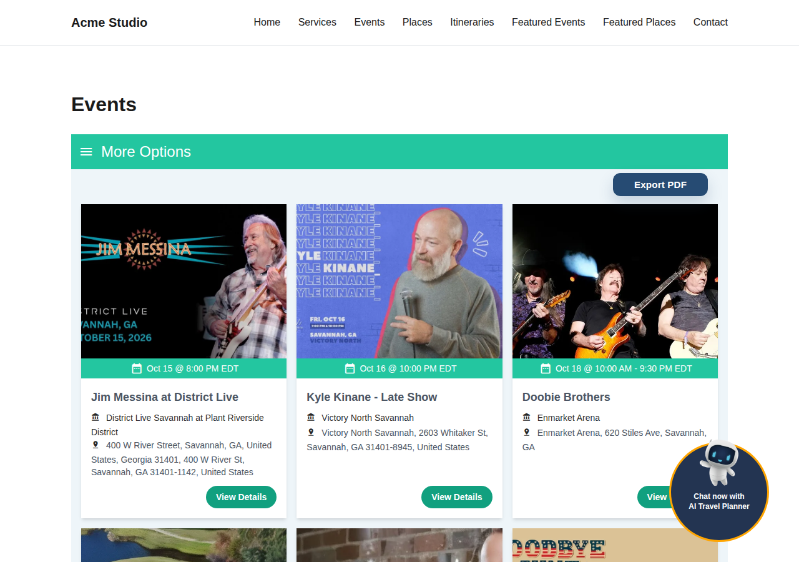
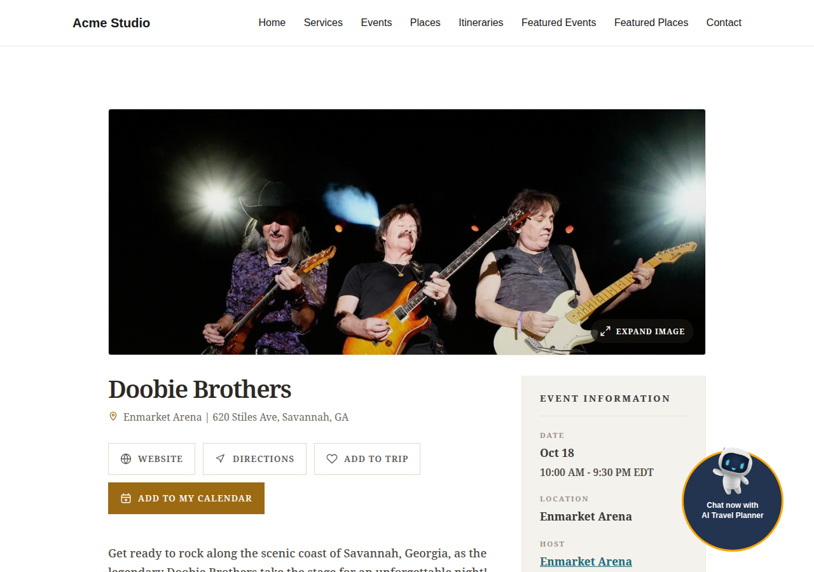
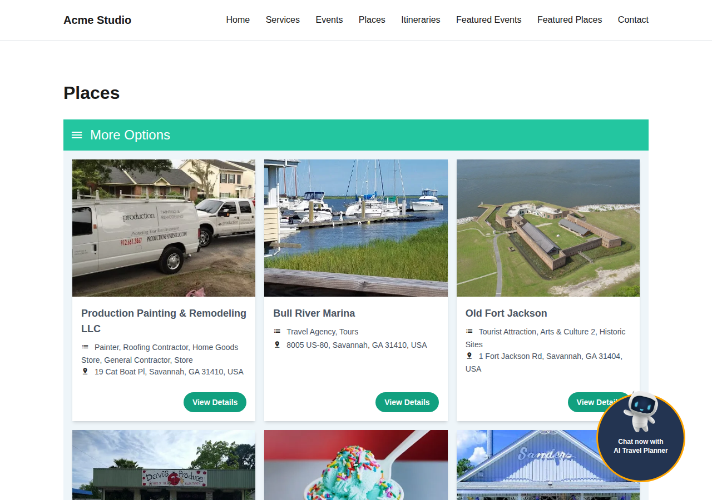
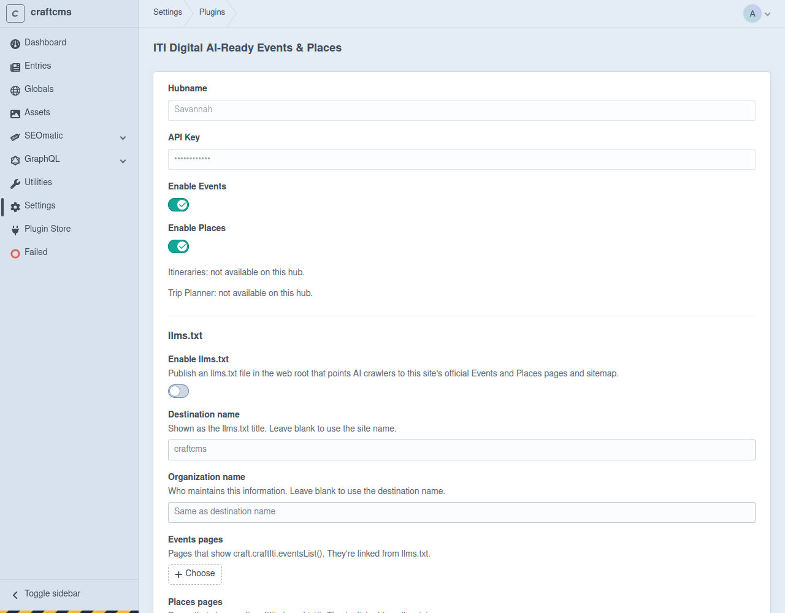

# ITI Digital AI-Ready Events & Places for Craft CMS

SEO-friendly Events, Places, Itineraries and Trip Planner integration for Craft CMS, powered by the [ITI Digital](https://iti-digital.com) platform. It is the Craft counterpart of the [WordPress plugin](https://wordpress.org/plugins/itidi-ai-events-places/).

Tourism content is rendered server-side so search engines and AI crawlers see real HTML, with clean URLs, structured data, a sitemap and `llms.txt` generated for you.

## Features

- API key authentication against your ITI Digital hub
- Server-side rendered Events, Places and Itineraries
- Clean detail URLs under `/e/` (Events) and `/p/` (Places), with overridable templates
- Optional 301 redirects for legacy `?event_id=` / `?place_id=` links
- SEO metadata, canonical URLs and structured data (SEOmatic integration)
- Dynamic events/places sitemap, added to SEOmatic's sitemap index automatically
- Authenticated webhook for real-time cache invalidation (Blitz supported)
- `/llms.txt` generation for AI crawler discovery
- Trip Planner widget with placement and path rules
- Event and Place submission forms
- `dataLayer` analytics events on detail pages
- Optional Craft search integration

## Screenshots

| Events listing | Event detail |
| --- | --- |
|  |  |

| Places listing | Plugin settings |
| --- | --- |
|  |  |

## Requirements

- Craft CMS 5.9.0 or later
- PHP 8.2 or later
- An active ITI Digital hub and API key. The plugin does not work without one.

## Installation

From the Craft Plugin Store, search for "ITI Digital AI-Ready Events & Places", or with Composer:

```bash
composer require iti/craft-iti-plugin
php craft plugin/install craft-iti-plugin
```

## Setup

1. Open **Settings → ITI Digital AI-Ready Events & Places**.
2. Enter the hub name and API key from ITI Digital and save. Modules enabled for your hub then appear.
3. Enable the Events, Places, Itineraries, llms.txt and Trip Planner modules you need.
4. Pick the entries that hold your listing pages and save.

## Templates

Render content from any Twig template:

```twig
{{ craft.craftIti.eventsList() }}
{{ craft.craftIti.placesList() }}
{{ craft.craftIti.itinerariesList({ widgetCode: 'default' }) }}
```

Detail pages are served at `<listing page>/e/<id>` and `<listing page>/p/<id>`. Override the default templates by placing your own at the same relative path in your site's `templates/` directory.

## llms.txt

When enabled, `web/llms.txt` is generated from the listing pages you pick, between `<!-- BEGIN/END ITI Digital llms.txt -->` markers so an existing file can be appended to safely. Regenerate manually with:

```bash
php craft craft-iti-plugin/llms/generate
```

Run it as the web server's user so the file stays writable by PHP.

## Webhook

Configure the webhook URL and secret shown in the plugin settings in your ITI Digital hub. Content, itinerary and module-status changes then purge the relevant caches immediately.

## Important notes

- Detail URLs live under `/e/` and `/p/` relative to the listing page. Avoid creating entries with those reserved path segments beneath a listing page, as they would conflict with dynamic detail URLs.
- The default detail templates are full pages. Internal layout pages are not meant to be public landing pages.
- Cache `/llms.txt`, the sitemap and detail routes sensibly at your host or CDN; the webhook purges them when content changes.

## FAQ

**What does this plugin require?**
An active ITI Digital hub with a valid API key. It depends on ITI Digital API responses and does not work without one.

**Why are some settings hidden?**
The plugin checks your hub and only shows modules enabled for it.

**How do I reset the connection?**
Use the Disconnect button on the settings page. It clears the saved hub connection and returns the plugin to first-time setup.

**Does the plugin add structured data?**
Yes. Detail pages output ITI Digital's schema, canonical URL and Open Graph data, and it works alongside SEOmatic.

**Can I use more than one listing page?**
Yes. Pick as many listing entries as you need; detail URLs resolve relative to the page they are opened from.

**Does it support cache-invalidation webhooks?**
Yes. Point the ITI Digital hub at the webhook URL and secret shown in settings; Event, Place and Itinerary changes refresh listings and purge cached detail pages.

**Why is my canonical URL different from what I expect?**
Check the canonical URL source and sitemap trailing-slash options in settings.

**Can I customize the detail templates?**
Yes. Place your own template at the same relative path under your site's `templates/` directory.

## Development

```bash
composer install
vendor/bin/phpunit
```

## Support

- Issues: https://github.com/Stellites-WP-Dept/ITI-Craft-plugin/issues
- ITI Digital: https://iti-digital.com

## License

MIT, see [LICENSE.md](LICENSE.md).
